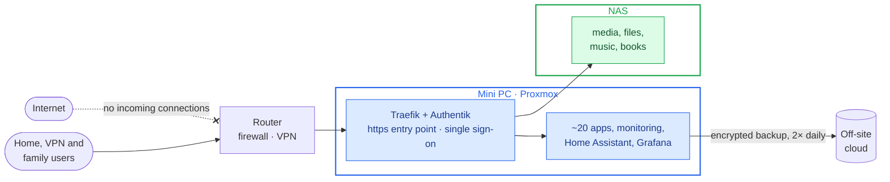
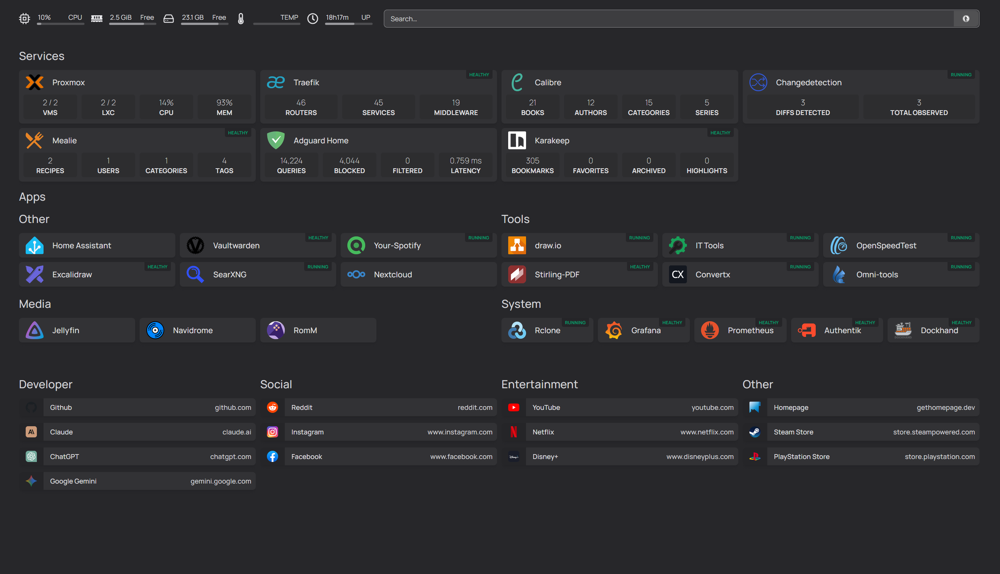
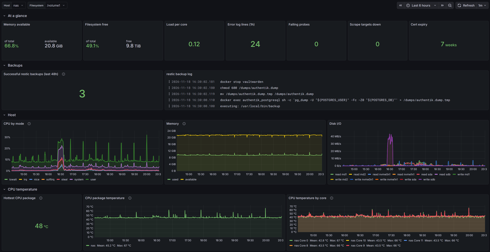
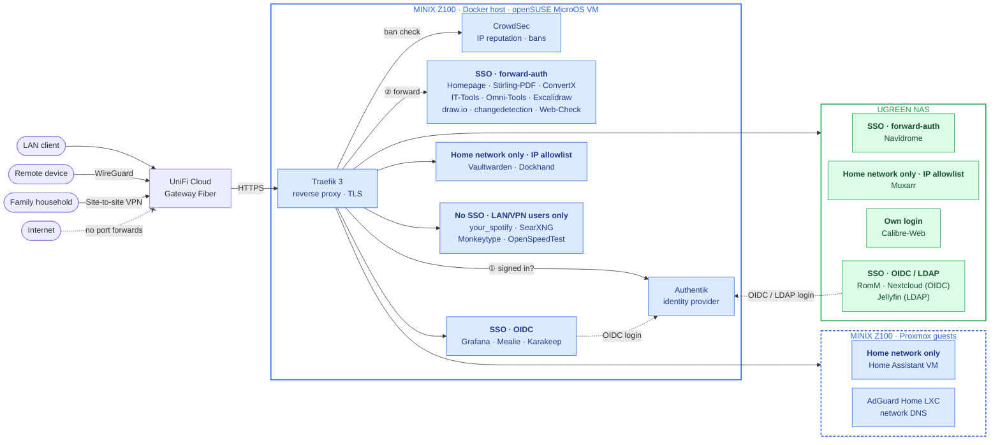
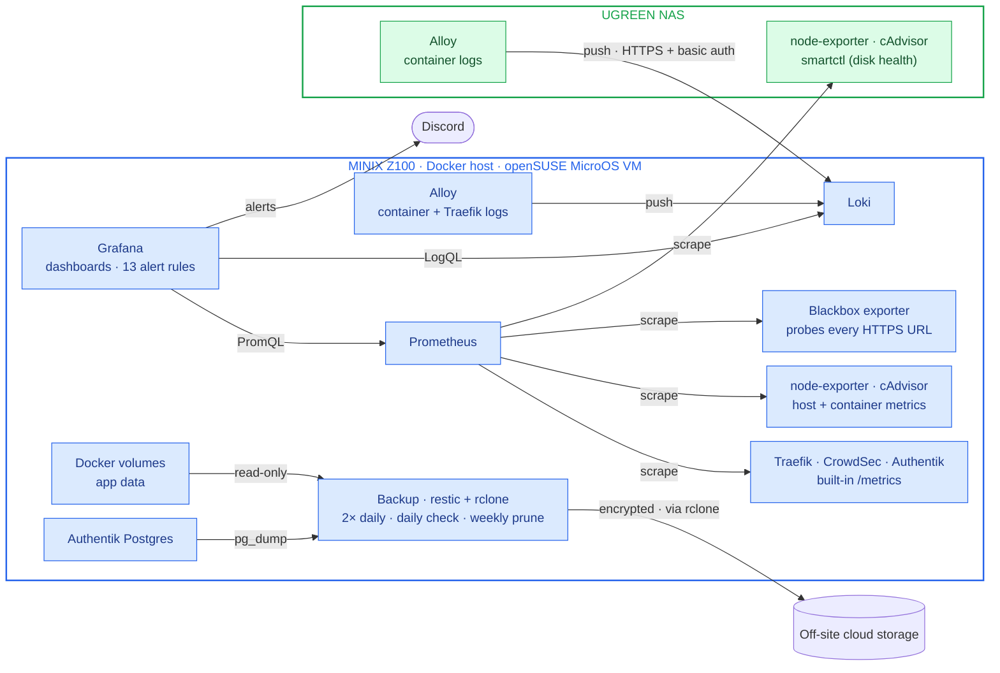

# Homelab

My Homelab project: a personal space to experiment, learn and self-host software.

My personal goal for this project was to learn and develop skills in self-hosting services, practice Linux, networking, virtualization and gain hands-on experience with enterprise-grade technologies (Proxmox, Grafana, Prometheus). This also gives me space to freely test, break and rebuild systems without risking my daily-use computers or professional production environments.

It's currently running on a MINIX Z100 mini PC and a UGREEN NAS DXP4800 Plus, running about 30 Docker stacks. It hosts my password manager, recipes, bookmarks, media, files, monitoring and a bunch of small tools. I use it every day along with my family.

My main focus was to implement best security practices. That is why there are no ports open to the internet, my network is segmented by VLANs and protected by firewall rules, and most containers are hardened.
Remote access happens by using WireGuard VPN or through a site-to-site VPN from my family household.

This repo is a snapshot of my configs. Domains, IPs and passwords are replaced with placeholders (`DOMAIN.TLD`, `NAS_IP`, `.env.example`).

## Overview





## Hardware

| Device | Role | Specs |
|---|---|---|
| Minix Z100-0db | Proxmox VE host | 16 GB RAM, 500 GB SSD, 2.5 GbE |
| UGREEN DXP4800 Plus | NAS, media and storage services | 32 GB RAM, 22 TB HDD (RAID 1) + 1 TB SSD, 2.5 GbE |
| UniFi Cloud Gateway Fiber | Router, firewall, VLANs, WireGuard | |
| 2× USW Flex 2.5G, U7 Pro XGS | Switching and Wi-Fi 7 | 2.5 GbE backbone |

On Proxmox I run the Docker host (a VM with most of the stacks in this repo), Home Assistant (VM), AdGuard Home for DNS (LXC) and an MQTT broker for IoT devices (LXC). The Docker host runs openSUSE MicroOS: the OS is read-only and updates are applied in one go on reboot, so a bad update can be rolled back. Jellyfin, Nextcloud and the other storage-heavy apps run on the NAS, next to the disks.

The Docker host VM is set up on first boot by a [combustion script](minipc-proxmox/microos/combustion/script), so a new VM comes up ready to use without any manual steps. It sets the hostname, creates an admin user that can only log in over SSH with a key, disables root login over SSH, installs Docker, Docker Compose and the QEMU guest agent, configures Docker log rotation, and turns on automatic nightly OS updates. The passwords and SSH key are placeholders, and the script refuses to run until they're filled in.

## Network and security

Nothing is reachable from the internet, because no ports are forwarded on the router. At home I use the services directly on the LAN, and away from home over WireGuard. My family's house is connected with a site-to-site VPN between our two routers, so they don't need to install and configure WireGuard while at home. Vaultwarden, Home Assistant, Proxmox, Dockhand, Prometheus and the Traefik dashboard only accept connections from my home network.

Every request goes through Traefik, which handles TLS and checks the client against CrowdSec's ban list. Most apps sit behind Authentik: the ones that support OIDC use it directly (Grafana, Mealie, Karakeep, RomM, Nextcloud), the others get Traefik forward-auth, and Jellyfin logs in through Authentik's LDAP outpost. Everyone in the family has their own account, and I'm the only admin. HTTPS works without open ports because the Let's Encrypt wildcard certificate comes from a DNS-01 challenge.

Containers start from `cap_drop: ALL` and only get back the capabilities they need. Most also run read-only, as a non-root user, with CPU and memory limits. Traefik, Homepage and Alloy reach the Docker API through their own socket proxies instead of the raw socket, and passwords are passed as Docker secrets or `*_FILE` variables.

## Services

### `minipc-proxmox/docker/` - Docker host (openSUSE MicroOS VM on Proxmox)

| Stack | What it does | Access control |
|---|---|---|
| [`proxy`](minipc-proxmox/docker/proxy) | [Traefik](https://github.com/traefik/traefik) reverse proxy, [CrowdSec](https://github.com/crowdsecurity/crowdsec) IPS, [docker-socket-proxy](https://github.com/Tecnativa/docker-socket-proxy) | Dashboard: LAN allowlist + basic auth |
| [`authentik`](minipc-proxmox/docker/authentik) | [Authentik](https://github.com/goauthentik/authentik) identity provider: OIDC, forward-auth, LDAP outpost | Own login |
| [`observability`](minipc-proxmox/docker/observability) | [Prometheus](https://github.com/prometheus/prometheus), [Grafana](https://github.com/grafana/grafana), [Loki](https://github.com/grafana/loki), [Alloy](https://github.com/grafana/alloy), [node-exporter](https://github.com/prometheus/node_exporter), [cAdvisor](https://github.com/google/cadvisor), [Blackbox](https://github.com/prometheus/blackbox_exporter) | Grafana: OIDC. Prometheus: LAN + SSO |
| [`backup`](minipc-proxmox/docker/backup) | [restic](https://github.com/restic/restic) backup / prune / check, [rclone](https://github.com/rclone/rclone) web UI | LAN allowlist + htpasswd |
| [`vaultwarden`](minipc-proxmox/docker/vaultwarden) | [Vaultwarden](https://github.com/dani-garcia/vaultwarden): password manager (Bitwarden-compatible) | LAN allowlist + own login |
| [`homepage`](minipc-proxmox/docker/homepage) | [Homepage](https://github.com/gethomepage/homepage): dashboard with live service widgets | Forward-auth |
| [`dockhand`](minipc-proxmox/docker/dockhand) | [Dockhand](https://github.com/Finsys/dockhand): Docker management UI | LAN allowlist + own login with 2FA |
| [`mealie`](minipc-proxmox/docker/mealie) | [Mealie](https://github.com/mealie-recipes/mealie): recipe manager | OIDC |
| [`karakeep`](minipc-proxmox/docker/karakeep) | [Karakeep](https://github.com/karakeep-app/karakeep): bookmark archive with full-text search (Meilisearch) | OIDC |
| [`changedetection`](minipc-proxmox/docker/changedetection) | [changedetection.io](https://github.com/dgtlmoon/changedetection.io): website change monitoring with headless Chrome | Forward-auth |
| [`stirling-pdf`](minipc-proxmox/docker/stirling-pdf), [`convertx`](minipc-proxmox/docker/convertx) | [Stirling-PDF](https://github.com/Stirling-Tools/Stirling-PDF): PDF tools. [ConvertX](https://github.com/C4illin/ConvertX): file conversion | Forward-auth |
| [`it-tools`](minipc-proxmox/docker/it-tools), [`omni-tools`](minipc-proxmox/docker/omni-tools) | [IT-Tools](https://github.com/CorentinTh/it-tools), [Omni-Tools](https://github.com/iib0011/omni-tools): developer utilities | Forward-auth |
| [`excalidraw`](minipc-proxmox/docker/excalidraw), [`drawio`](minipc-proxmox/docker/drawio) | [Excalidraw](https://github.com/excalidraw/excalidraw), [draw.io](https://github.com/jgraph/drawio): diagramming | Forward-auth |
| [`webcheck`](minipc-proxmox/docker/webcheck) | [Web-Check](https://github.com/Lissy93/web-check): website / OSINT analysis | LAN allowlist + forward-auth |
| [`searxng`](minipc-proxmox/docker/searxng) | [SearXNG](https://github.com/searxng/searxng): private metasearch engine | CrowdSec + rate limit |
| [`your_spotify`](minipc-proxmox/docker/your_spotify) | [your_spotify](https://github.com/Yooooomi/your_spotify): Spotify listening statistics (MongoDB) | Spotify OAuth |
| [`monkeytype`](minipc-proxmox/docker/monkeytype), [`openspeedtest`](minipc-proxmox/docker/openspeedtest) | [Monkeytype](https://github.com/monkeytypegame/monkeytype): typing practice. [OpenSpeedTest](https://github.com/openspeedtest/Speed-Test): LAN speed test | CrowdSec / rate limit |

### `nas-ugreen/docker/` - UGREEN NAS

| Stack | What it does | Access control |
|---|---|---|
| [`mediastack`](nas-ugreen/docker/mediastack) | [Jellyfin](https://github.com/jellyfin/jellyfin) (Intel GPU hardware transcoding) + [Muxarr](https://github.com/KirovAir/muxarr) (audio/subtitle track cleanup) | Jellyfin: LDAP via Authentik. Muxarr: LAN allowlist |
| [`tvheadend`](nas-ugreen/docker/tvheadend) | [TVHeadend](https://github.com/tvheadend/tvheadend): DVB-T2 tuner server / PVR, feeds live TV to Jellyfin | LAN only |
| [`nextcloud`](nas-ugreen/docker/nextcloud) | [Nextcloud All-in-One](https://github.com/nextcloud/all-in-one): files, calendar, office | OIDC |
| [`navidrome`](nas-ugreen/docker/navidrome) | [Navidrome](https://github.com/navidrome/navidrome): music streaming with a Subsonic API | Forward-auth (web), Subsonic auth (API) |
| [`calibre-web-automated`](nas-ugreen/docker/calibre-web-automated) | [Calibre-Web-Automated](https://github.com/crocodilestick/Calibre-Web-Automated): e-book library with automatic ingest | OIDC |
| [`romm`](nas-ugreen/docker/romm) | [RomM](https://github.com/rommapp/romm): retro game library manager (MariaDB) | OIDC |
| [`observability`](nas-ugreen/docker/observability) | [node-exporter](https://github.com/prometheus/node_exporter), [cAdvisor](https://github.com/google/cadvisor), [smartctl-exporter](https://github.com/prometheus-community/smartctl_exporter), [Alloy](https://github.com/grafana/alloy) (logs to Loki) | Scraped by Prometheus over the LAN |
| [`modmanager`](nas-ugreen/docker/modmanager) | [modmanager](https://github.com/linuxserver/docker-modmanager): caches LinuxServer.io Docker mods for Jellyfin | n/a |

## Monitoring

Prometheus scrapes both hosts (node-exporter, cAdvisor, and SMART data on the NAS), plus Traefik, CrowdSec, Authentik, Loki and Alloy. Blackbox checks that every service URL responds and when its certificate expires, and Alloy sends container logs and the Traefik access log from both hosts to Loki. The dashboards and 13 Grafana alert rules are kept as files. The alerts cover disk, memory and load, containers that restart or hit their limits, failing probes, expiring certificates, Traefik errors, and a missed backup.



## Backups and updates

restic backs up the Docker host's app data to off-site cloud storage through rclone twice a day. Postgres gets a `pg_dump` first, and apps that use SQLite or MongoDB are stopped during the snapshot so the copy is consistent. A daily `restic check` reads back 10% of the data.

Core infrastructure containers (Traefik, CrowdSec, Authentik and the monitoring stack) are pinned to specific versions and updated by hand. Most other images use `latest`, and Dockhand updates them every day at 6:00, after the morning backup has finished.

## Limitations

- Everything except the NAS runs on one mini PC, so there's no failover. If it goes down, so do the apps and the single sign-on.
- No WAN failover, so in case the internet goes down, remote access over VPN or site-to-site VPN is not possible.
- The off-site backup only covers the Docker host. Data on the NAS isn't part of it (yet).
- Most images follow `latest` and update automatically, so a bad release can reach the lab before I've read about it. The restart and probe alerts are what catch it.

## Detailed diagrams

The flow of requests, logins, metrics and backups. Blue runs on the mini PC (the dashed frame is the Proxmox VMs and LXCs outside the Docker host), green on the NAS.

<details>
<summary><b>Requests and logins</b></summary>

Every request goes through the UniFi gateway to Traefik, which handles TLS and checks the client IP against CrowdSec's ban list. After that it depends on the app:

- **SSO · forward-auth:** Traefik asks Authentik if you're signed in (①) and only then passes the request on (②). These apps have no login of their own.
- **SSO · OIDC / LDAP:** the app's login sends you to Authentik, or checks your password against Authentik's LDAP outpost.
- **Home network only:** Traefik only lets in IPs from my home network.
- **No SSO / own login:** still only reachable from the LAN or over VPN. They either have their own login or don't hold anything sensitive.



</details>

<details>
<summary><b>Monitoring and backup</b></summary>

Prometheus pulls metrics, Alloy pushes logs to Loki, and Grafana reads from both. Backups are separate and go off-site.



</details>

## Repository layout

```
.
├── minipc-proxmox/
│   ├── docker/<stack>/       docker-compose.yml, .env.example, config files
│   └── microos/combustion/   first-boot setup script for the Docker host VM
└── nas-ugreen/
    └── docker/<stack>/
```

- One folder per Compose project, grouped by the machine it runs on.
- Every stack has a `.env.example`. Real `.env` files, `secrets/` and runtime data are git-ignored.
- The shared networks `proxy`, `metrics` and `mediastack` (on the NAS) need to be created once with `docker network create <name>`.
- Traefik picks up Docker containers from their labels (default rule `Host(<container>.DOMAIN.TLD)`). The NAS and Proxmox services are routed through the file provider in `proxy/traefik/data/dynamic/`.

## Roadmap

- Add Immich for photo storage
- Implement GitOps and make the repo a single source of truth for the Homelab
    - A Git repository would hold the whole configuration of the lab, and a deploy agent on each host would apply every change merged into it. Every change would be reviewed and recorded in the history, the hosts couldn't drift from what's in Git, and rolling back would be a `git revert`.
- Move Authentik configuration to yaml templates
- Update management using Renovate
    - [Renovate](https://docs.renovatebot.com) watches the image tags in the compose files and opens a pull request when a new version comes out, with the release notes attached. That would let me pin every image, including the ones on `latest` today, review each update before merging, and replace the automatic Dockhand updates.
- Investigate adding Content-Security-Policy to the shared security-headers middleware to improve security
    - A Content-Security-Policy header tells the browser which sources a page may load scripts, styles and images from, which limits the damage of an XSS bug. The hard part is that one shared middleware serves about 20 different apps, so I'd start in report-only mode and probably end up with a few per-app policies.
- Safe remote access without VPN using Pangolin hosted on a VPS
    - [Pangolin](https://pangolin.net) is a self-hosted tunnelled reverse proxy. It runs on a small VPS, and a client in my network connects out to it over WireGuard, so I still don't have to open any ports at home. That would let me share selected apps with people who don't have a VPN, with a login in front of them.
